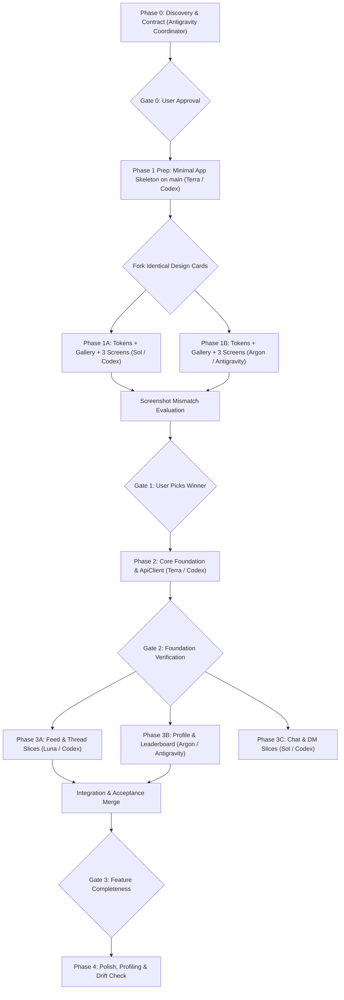

# VNLF Flutter Client: Architectural Master Plan & Execution Graph

---

## 1. Project Overview & Standards

Build a high-performance, native Flutter client for `vietnamlinuxfamily.net` (Vietnam Linux Family community) targeting Linux and Android first-class (with iOS, Windows, macOS, and Web feasibility). The application visually replicates the web client's exact design system while adhering to native Flutter performance standards (60/120fps, <2s cold start, zero rebuild storms, and zero slop).

---

## 2. System Architecture

```
                  +----------------------------------------------+
                  |         Presentation Layer (UI & State)       |
                  |  - Flutter Widgets (const, slivers, adaptive)|
                  |  - Riverpod Notifiers (AsyncNotifier, State) |
                  |  - GoRouter Declarative Routing & Shells    |
                  +----------------------------------------------+
                                         |
                                         v
                  +----------------------------------------------+
                  |             Domain Layer (Pure Dart)         |
                  |  - Immutable Domain Entities (Freezed)       |
                  |  - Repository Interfaces                     |
                  |  - Sealed Error & Result Types               |
                  +----------------------------------------------+
                                         |
                                         v
                  +----------------------------------------------+
                  |          Data Layer & Anti-Corruption        |
                  |  - Repository Implementations                |
                  |  - DTOs with Tolerant JSON Parsing           |
                  |  - Typed ApiClient (Interceptors, Retry)     |
                  |  - CookieJar & Secure Storage Engine         |
                  |  - Fake Server Adapter (Dev / Test / CI)     |
                  +----------------------------------------------+
```

### Clean Architecture Rules
1. **Feature-First Organization**: Slices live in `lib/src/features/<feature>/` divided into `presentation`, `domain`, and `data`.
2. **Anti-Corruption Layer**:
   - Web server sends unstructured/loose fields; DTOs parse tolerantly with `@JsonKey(defaultValue: ...)` ignoring unknown fields.
   - DTOs are mapped to immutable Domain Models via explicit extension mappers (e.g. `toDomain()`).
   - Network layer uses `ApiClient` with standard interceptors: automatic `x-vnlf-client` injection, cookie session persistence, exponential backoff with jitter on 429/503, and typed error transformation.
3. **Domain Layer Independence**:
   - Zero Flutter UI imports in domain logic.
   - Repositories are abstract Dart interfaces. Presentation layer depends on Riverpod providers that resolve repository interfaces.
4. **Offline & Recorded Fake Server**:
   - A standalone fake HTTP & WebSocket server (`test/fixtures/fake_server.dart`) runs on a port passed via environment variable `VNLF_FAKE_SERVER_PORT`.
   - Powers widget golden tests, integration tests, and local offline development without touching production servers.

---

## 3. Verified Dependencies (pubspec.yaml)

Managed exclusively by **Core (Codex, GPT-6.1 Terra)**:

| Package | Version | Purpose | pub.dev Verification |
| :--- | :--- | :--- | :--- |
| `flutter_riverpod` | `^2.6.1` | Reactive state management | Stable, standard |
| `riverpod_annotation` | `^2.6.1` | Riverpod code generation | Stable |
| `go_router` | `^14.8.1` | Declarative routing & responsive navigation shells | Flutter standard |
| `dio` | `^5.8.0` | HTTP client with interceptors | Stable |
| `dio_cookie_manager` | `^4.0.0` | Cookie management for Dio | Stable |
| `cookie_jar` | `^4.0.8` | In-memory & persisted cookie jar | Stable |
| `flutter_secure_storage`| `^9.2.4`| Secure storage for UUID & session state | Cross-platform secure |
| `freezed_annotation` | `^2.4.4` | Immutable value objects & sealed unions | Standard |
| `json_annotation` | `^4.9.0` | JSON serialization annotation | Standard |
| `google_fonts` | `^6.2.1` | `Be Vietnam Pro` typeface integration | Official Google package |
| `cached_network_image` | `^3.4.1` | Cached network images with shimmer placeholder | High performance |
| `web_socket_channel` | `^3.0.3` | Realtime community WebSocket client | Official Dart package |
| `intl` | `^0.20.2` | Date/time and currency formatting in Vietnamese | Official Dart package |
| `flutter_svg` | `^2.0.17` | SVG icon & badge rendering | Standard |
| `livekit_client` | `^2.3.4` | Voice rooms WebRTC SFU client | Official LiveKit SDK |

Dev Dependencies:
- `build_runner`, `freezed`, `json_serializable`, `riverpod_generator`, `flutter_test`, `flutter_lints`.

---

## 4. Feature Inventory

1. **Authentication & Session**:
   - Login, registration, password validation, session restore, logout.
   - Secure persistent storage of `x-vnlf-client` and session cookies.
2. **Community Feed (Bảng tin)**:
   - Feed tabs: `Mới nhất`, `Được chú ý`, `Article`, `Đang theo dõi`.
   - Infinite scroll with pagination cursor, pull-to-refresh.
   - Full post cards with author styling (frames, distro badges, nameplates).
3. **Post & Article Details**:
   - Markdown body rendering with syntax highlighted code blocks.
   - Image preview carousel and lightbox fullscreen viewer.
   - Upvote / Score / Downvote capsule widget.
   - Bookmark toggle and native share sheet trigger.
4. **Comments & Threading**:
   - Nested hierarchical comment tree.
   - In-line comment composer, parent reply references.
   - Comment voting and author attribution.
5. **Community Channels & Chat**:
   - Channel directory list with category groupings.
   - Realtime message feed with emoji reactions and stickers.
   - User mention autocompletion (`@username`).
6. **Direct Messaging (DM)**:
   - Conversations list with unread counters.
   - Peer-to-peer chat threads with read receipt indicators.
7. **Projects Directory (Dự án)**:
   - Filterable projects showcase (Distros, Apps, Customizations, Vietnamese tools).
   - GitHub repo stats (stars, forks, language badges) and ratings.
8. **Gamification & Leaderboard (Xếp hạng tuần)**:
   - Weekly, monthly, and all-time top contributors.
   - Karma point breakdown, activity rules, and daily check-in claims.
9. **User Profiles & Wardrobe Customization**:
   - User profile hero banner, statistics, authored posts, and showcase projects.
   - Stylized avatar frames (`matrix`, `neon`, `stars`), name effects (`rainbow`, `glitch`, `cursor`), and distro badges.
10. **Voice Channels (Voice)**:
    - Audio room directory and participant rosters.
    - LiveKit audio connection, mute/unmute, and speaking indicators.
11. **Settings & Themes**:
    - Dark mode, light mode, and system auto-follow.
    - Text size scaler (`12px` - `18px`).

---

## 5. Risks, Constraints & Gate 0 Decisions

| Risk / Area | Severity | Impact & Policy Decisions |
| :--- | :--- | :--- |
| **Auth Contract Unknown (Top Risk)** | Critical | Authenticated session shape, cookies/CSRF, set-cookie attributes, and live login response remain **[UNKNOWN]**. **Mitigation (Gate 0)**: Phase 2 auth work stays strictly behind an abstract repository interface (`AuthRepository`) with a fake implementation only. The real login and session flow will be captured in Phase 3 exclusively from the user's manual HAR/cURL export from their own browser session. No agent drives the user's browser or runs scripts in it. |
| **CORS & Web Platform** | High for Web, None for Native | **Decision (Gate 0)**: Native platforms (Linux and Android first-class; iOS, Windows, macOS) are shipped directly without CORS issues. Flutter Web is strictly **dev-only through a local proxy** and is **not shipped**. No hosted proxy will be built or proposed. Recorded as a permanent risk; to be revisited only if site owners enable CORS headers in production. |
| **Test Environment & Fixtures** | Zero risk to prod | **Decision (Gate 0)**: Core and Features develop against the recorded fake server (`VNLF_FAKE_SERVER_PORT`) exclusively. No live writes until the coordinator is provided a dedicated test account and sandbox thread. All fixtures preserve exact production JSON shapes while using **invented Vietnamese content and synthetic names** (zero real user data, avatars, tokens, or emails). |
| **Session Cookie Management** | Medium | Managed via `dio` + `dio_cookie_manager` and encrypted persistent storage. Replicates web client's cookie jar behavior and client-id injection. |
| **Server Rate Limits & Live Traffic** | High | Strict policy: No automated polling loops. Every new live request outside read-only GETs requires explicit user approval. All discovery traffic was audited and sanitized. |
| **Typography & Font Licensing** | Low | `Be Vietnam Pro` is licensed under the SIL Open Font License 1.1 (OFL-1.1), permitting embedding and bundling. Asset files will be verified and checked into the project skeleton. |

---

## 6. Execution Graph & Phase Breakdown



### Phase 1 Execution Sequence
1. **Skeleton Commit on main (Core: Codex, GPT-6.1 Terra)**:
   - Create minimal Flutter app skeleton: `flutter create --org net.vietnamlinuxfamily --project-name vnlfsocialapp .`
   - Configure strict `analysis_options.yaml`.
   - Configure `pubspec.yaml` with only justified dependencies (`flutter_riverpod`, `riverpod_annotation`, `go_router`, `freezed_annotation`, `json_annotation`, `dio`, `dio_cookie_manager`, `cookie_jar`, `flutter_secure_storage`, `intl`, `flutter_svg`).
   - Bundle `Be Vietnam Pro` font asset in `assets/fonts/` with license file.
   - Scaffold empty `lib/src/design_system/` and a gallery entry route at `/gallery`.
   - Verify `flutter analyze` and commit directly to `main`.
2. **Parallel Exploration (Max 2 Workers)**:
   - Fork child worktree `vnlf-design-sol` (UX/UI A: Codex, GPT-6.1 Sol).
   - Fork child worktree `vnlf-design-argon` (UX/UI B: Antigravity, Gemini 4 Argon).
   - **Identical Task Cards**: Design tokens, component gallery, and 3 key screens (`feed`, `thread`, `profile`) rendered at phone (<= 840px) and desktop (>= 1181px) widths.
   - **Owned Paths**: `lib/src/design_system/**`, `lib/src/gallery/**`. Read-only: `pubspec.yaml` (never edit).
3. **Evaluation**:
   - Compare Linux app screenshots against reference capture.
   - Produce side-by-side mismatch lists per branch for user selection at Gate 1.

### Team Role & Worker Mapping

1. **Coordinator (You: Antigravity, Gemini 3.8 Flash)**:
   - Owns `PLAN.md`, `API_NOTES.md`, `DESIGN_REFERENCE.md`, orchestrating child worktrees, and integration testing.
2. **Core (Codex, GPT-6.1 Terra)**:
   - Worktree: `vnlf-core` on branch `feat/core-foundation`
   - Owned paths: `lib/src/core/**`, `lib/src/network/**`, `pubspec.yaml`, `pubspec.lock`
   - Scope: ApiClient, auth repository, cookie persistence, fake server runner.
3. **Features (Codex, GPT-6 Luna)**:
   - Worktree: `vnlf-features` on branch `feat/feed-slices`
   - Owned paths: `lib/src/features/feed/**`, `lib/src/features/articles/**`, `test/features/**`
   - Scope: Feed domain/data/presentation, comments, and tests.
4. **UX/UI A (Codex, GPT-6.1 Sol)**:
   - Worktree: `vnlf-design-sol` on branch `feat/design-system-sol`
   - Owned paths: `lib/src/design_system/**`
   - Scope: Design tokens, atomic components, motion animations.
5. **UX/UI B (Antigravity, Gemini 4 Argon)**:
   - Worktree: `vnlf-design-argon` on branch `feat/design-system-argon`
   - Owned paths: `lib/src/design_system_argon/**` (or parallel slice)
   - Scope: Responsive shells, 3 key screens (Feed, Post, Profile), comparing side-by-side with reference.
