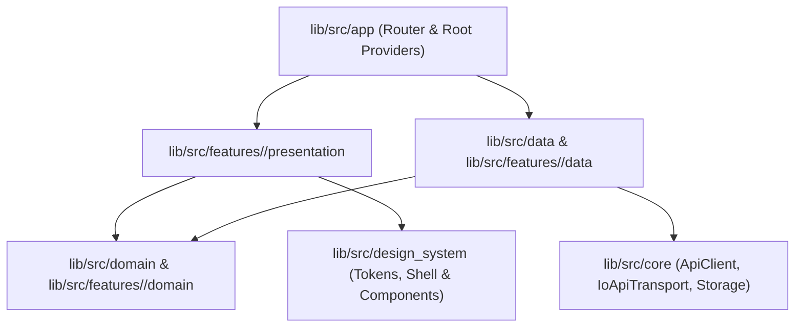

# Development Guide (`VNLF Social`)

This guide covers local environment setup, architecture conventions, feature development workflows, testing harnesses, and troubleshooting for the native **VNLF Social** Flutter client.

Before writing code, review:
- [`AGENTS.md`](../AGENTS.md) — Operating rules and architectural invariants
- [`CONTRIBUTING.md`](../CONTRIBUTING.md) — Contribution workflow and PR verification gates
- [`API_NOTES.md`](../API_NOTES.md) — Confirmed server REST & WebSocket contracts
- [`DESIGN_REFERENCE.md`](../DESIGN_REFERENCE.md) — Design tokens, layout tiers, and UI specifications
- [`docs/BUILD_AND_RELEASE.md`](BUILD_AND_RELEASE.md) — CI/CD matrix, Android signing, and release packaging

---

## 1. Prerequisites & Workstation Setup

### Flutter & Dart SDK
- Use the Flutter stable version pinned in [`.github/workflows/ci.yml`](../.github/workflows/ci.yml) and [`.github/workflows/build.yml`](../.github/workflows/build.yml) (**Flutter `3.47.9`**, tag commit `c197ca5199e9ee5661e865596c9c07294dfab51c`).
- Verify your active toolchain:
  ```sh
  flutter --version
  python3 --version
  ```

### Linux System Dependencies
Building and running the native Linux client requires GTK 3, X11/XI, `libmpv` (ABI 2), `libepoxy`, `libsecret-1`, and `xvfb` (for headless widget/visual tests). Install them with the repository helper or `apt`:
```sh
python3 tool/install_linux_dependencies.py
# Or manually on Ubuntu/Debian:
sudo apt-get update && sudo apt-get install -y --no-install-recommends \
  clang cmake ninja-build pkg-config \
  libgtk-3-dev libx11-dev libxi-dev \
  libmpv-dev libepoxy-dev libsecret-1-dev \
  xvfb
```
> **Note on Linux Secure Storage**: Persistent session storage and encrypted draft recovery on Linux rely on `flutter_secure_storage_linux` via `libsecret`. An unlocked Secret Service provider (such as GNOME Keyring or KWallet) must be running in the user session. When unavailable, the app degrades gracefully for guest browsing and surfaces a typed storage notice in Settings.

### Platform-Specific Notes
- **Android**: Requires JDK 17+, Android SDK Build-Tools `35.0.0+` / `36.0.0`, and NDK configured via Gradle (`android/gradle/wrapper/gradle-wrapper.properties` uses `gradle-9.3.1-bin.zip` with a bounded `1536 MB` heap and `--no-daemon`).
- **Windows**: Uses `video_player_win` (Windows Media Foundation) for native video playback on both `x64` and `arm64` without external `libmpv` archives (see [`docs/decisions/0001-native-windows-video.md`](decisions/0001-native-windows-video.md)).
- **macOS**: Requires Xcode `26.3+` (SDK 26 required by `connectivity_plus` `NWPath` APIs) and CocoaPods.

---

## 2. Local Resource Guard (`tool/with_build_slot.sh`)

To prevent out-of-memory crashes and CPU contention on 8 GB workstations or multi-worktree environments, **never invoke concurrent Flutter/Dart/Gradle build or test processes**. Always wrap SDK commands with [`tool/with_build_slot.sh`](../tool/with_build_slot.sh):

```sh
tool/with_build_slot.sh flutter pub get
tool/with_build_slot.sh flutter run -d linux
```

How `tool/with_build_slot.sh` works:
- Acquires an exclusive cross-worktree lockfile (`/tmp/vnlf-build.lock`). If another build or test is already running, it exits immediately with code `75` (`EX_TEMPFAIL`) rather than queuing unbounded memory consumers.
- Pins CPU affinity to at most 2 cores (`taskset -c`) and lowers CPU/I/O scheduling priority (`nice -n 10`, `ionice -c2 -n7`).

---

## 3. Architecture Deep Dive

The codebase follows **Feature-First Clean Architecture** with **Riverpod** (`flutter_riverpod`) for state management and **GoRouter** (`go_router`) for declarative navigation.

### Layer Dependency Graph



### Module Responsibilities

1. **`lib/src/core/` — Transport & Platform Infrastructure**:
   - [`api_client.dart`](../lib/src/core/api_client.dart): Typed HTTP client interface, request throttling, GET response caching, mutation cache invalidation, and `ApiSessionScope` account-isolation guards.
   - [`io_api_transport.dart`](../lib/src/core/io_api_transport.dart): Native `dart:io` HTTP/WebSocket transport with cookie jar management, automatic `x-vnlf-client` header injection, and authenticated `/ws/community` WebSocket upgrade.
   - [`session_storage.dart`](../lib/src/core/session_storage.dart) & [`preferences_storage.dart`](../lib/src/core/preferences_storage.dart): Secure credential/cookie storage (`flutter_secure_storage`) separated from non-secret UI preferences (`shared_preferences`).

2. **`lib/src/domain/` & `lib/src/features/<slice>/domain/` — Pure Domain Layer**:
   - Immutable entities, value objects, sealed state/error unions, and abstract repository interfaces.
   - **Strict rule**: Zero imports from `presentation/`, `data/`, `design_system/`, `gallery/`, or Flutter widget libraries (`material.dart`, `widgets.dart`, `cupertino.dart`).

3. **`lib/src/data/` & `lib/src/features/<slice>/data/` — Anti-Corruption Layer**:
   - Concrete repository implementations (`live_*_repository.dart`, `fixture_*_repository.dart`) and DTO mappers (`*_dto.dart`).
   - Uses [`field_reader.dart`](../lib/src/data/field_reader.dart) for tolerant JSON parsing: ignores unexpected fields, normalizes nullable/optional values safely, and converts contract violations into typed `ApiException` errors.

4. **`lib/src/design_system/` — Design Tokens & Shared Components**:
   - `tokens/`: Color palettes (`vnlf_colors.dart`), typography (`vnlf_typography.dart`), spacing/breakpoints/radii (`vnlf_dimensions.dart`), and Material 3 theme builders (`vnlf_theme.dart`).
   - `components/`: Adaptive 3-tier shell (`vnlf_shell.dart`), post cards, comment trees, code blocks, media galleries, video surfaces, avatars, and skeletons.
   - **Strict rule**: Must never import `features/`, `data/`, `app/`, or `gallery/`.

5. **`lib/src/features/<slice>/` — Feature Slices**:
   Each feature slice (`activity`, `auth`, `channels`, `communication`, `composer`, `direct_messages`, `discover`, `feed`, `feedback`, `leaderboard`, `moderation`, `notifications`, `polls`, `profile`, `projects`, `realtime`, `search`, `settings`, `shared`, `thread`, `updates`, `voice`) encapsulates its own `domain/`, `data/`, and `presentation/` sub-packages.

---

## 4. Runtime Modes & Server Environments

### 1. Fixture Mode vs Live Mode
- By default in automated tests, repositories use synthetic fixtures from `test/fixtures/` or in-memory fake transports.
- Live HTTP/WebSocket transport is controlled by `VNLF_LIVE` and the active server endpoint in [`lib/src/app/providers.dart`](../lib/src/app/providers.dart).

### 2. Server Endpoints (Production vs Dev)
- **Production (`https://vietnamlinuxfamily.net`)**: Default server in both debug and release builds.
- **Local Development (`http://localhost:3001`)**: Available in the Settings server selector **only in non-release builds** (`!kReleaseMode`). Release builds lock to production and hide the server switcher.

### 3. Standalone Fake Server (`test/fixtures/fake_server.dart`)
- For offline integration testing and contract verification, `test/fixtures/fake_server.dart` serves recorded synthetic JSON fixtures over loopback HTTP.

---

## 5. Adding or Modifying a Feature

1. **Verify the Contract**:
   - Check [`API_NOTES.md`](../API_NOTES.md) and `docs/contracts/`. Never guess an endpoint path, HTTP method, or JSON field.
2. **Define Domain Models & Repository Interface (`lib/src/features/<slice>/domain/`)**:
   - Keep models immutable with value equality.
   - For any write operation (`POST`, `PUT`, `PATCH`, `DELETE`), include an explicit idempotency key or version token if supported by the server contract, and never auto-retry failed writes.
3. **Implement DTO & Repository (`lib/src/features/<slice>/data/`)**:
   - Parse responses using `FieldReader`.
   - Guard all async mutations with the active `ApiSessionScope` / `RequestIdentity` so account switches or logouts discard stale results.
4. **Build Presentation & Localization (`lib/src/features/<slice>/presentation/`)**:
   - Take copy from `lib/src/i18n/vi.dart` (the website's keys); add native-only copy to `ViApp` there.
   - Use tokens from `lib/src/design_system/design_system.dart`.
   - Handle all 4 states explicitly: `loading`, `empty`, `error` (with retry callback), and `data`.
5. **Write Tests (`test/features/<slice>/`)**:
   - Place tests inside `test/features/<slice>/<name>_test.dart`.
   - Test success acknowledgments, server errors (`401`, `403`, `404`, `422`, `429`, `500`), account/session changes mid-request, and responsive layouts (`390px`, `900px`, `1440px` at up to `2.0x` text scale).

---

## 6. Testing & Verification Suites

Run all test suites via `tool/with_build_slot.sh`:

```sh
# 1. Static analysis & formatting check
tool/with_build_slot.sh dart format --output=none --set-exit-if-changed lib test tool
tool/with_build_slot.sh flutter analyze

# 2. Pure-Dart HTTP & session transport smoke test
tool/with_build_slot.sh dart run test/core/io_transport_headless_smoke.dart

# 3. Project layout & Clean Architecture boundary contract test
tool/with_build_slot.sh flutter test --concurrency=1 test/core/project_layout_contract_test.dart

# 4. Full Flutter unit, widget & UX regression suite
tool/with_build_slot.sh flutter test --concurrency=1

# 5. Python build, signing & release tooling unit tests
python3 -m unittest discover -s test/tool -p '*_test.py'
```

### Synthetic Visual Audit Capture (Linux Xvfb)
To regenerate the 132 synthetic route screenshots (across `390px`, `900px`, `1440px` in light and dark themes) without touching any live server:
```sh
tool/with_build_slot.sh xvfb-run -a -s "-screen 0 1600x1200x24" \
  flutter test --concurrency=1 tool/ux_audit_capture.dart
```

---

## 7. Troubleshooting

- **`tool/with_build_slot.sh` exits with code `75`**:
  Another Flutter, Dart, or Gradle command is currently holding `/tmp/vnlf-build.lock`. Wait for it to finish or inspect active processes with `ps aux | grep -E "flutter|dart|gradle"`.
- **Linux build fails with missing `mpv` / `epoxy` / `libsecret-1` pkg-config headers**:
  Run `python3 tool/install_linux_dependencies.py` or install `libmpv-dev libepoxy-dev libsecret-1-dev`.
- **Headless Linux widget tests fail to open a display**:
  Prefix the test command with `xvfb-run --auto-servernum`.
- **Android APK `INSTALL_FAILED_UPDATE_INCOMPATIBLE` or `INSTALL_FAILED_VERSION_DOWNGRADE`**:
  Official releases are signed with the permanent VNLF release keystore (`SHA-256: F7:67:2A:85:70:A1:B2:97:0C:65:50:AF:A1:1B:87:58:96:3F:D7:01:6B:FB:9D:AE:54:BE:F4:E4:06:FB:7F:47`) and use ABI-split `versionCode` with a `+3000` offset (`android/app/build.gradle.kts`). If a device previously installed an unsigned/debug-signed development APK, uninstall that dev build once before installing official release `.apk` files; all subsequent official `.apk` updates upgrade in-place (`adb install -r`).
