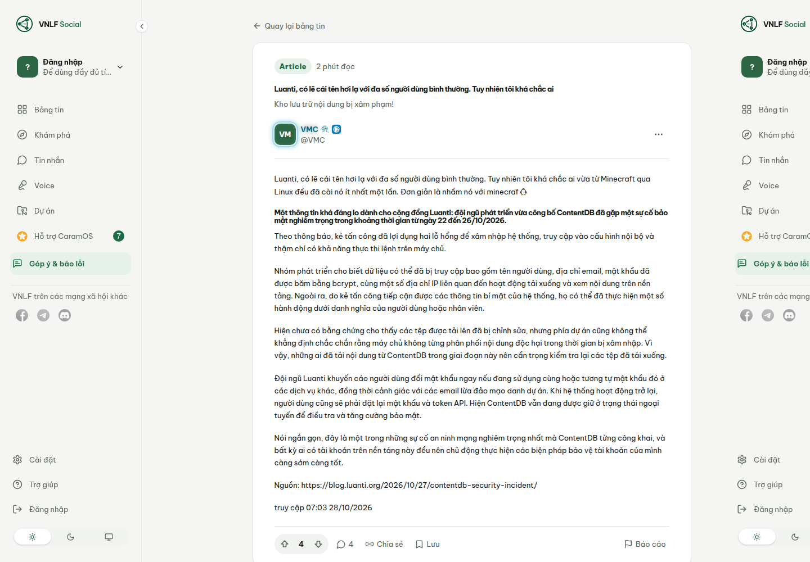
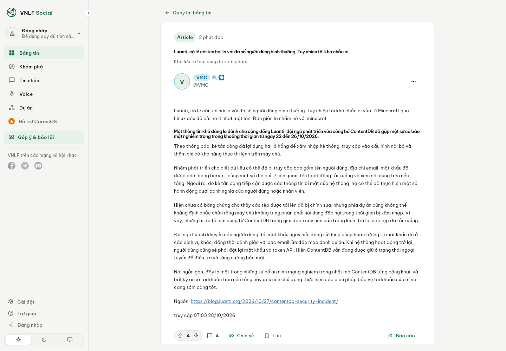
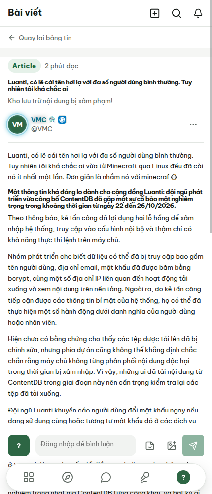
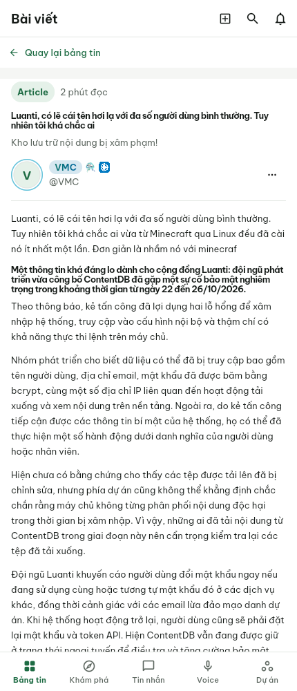
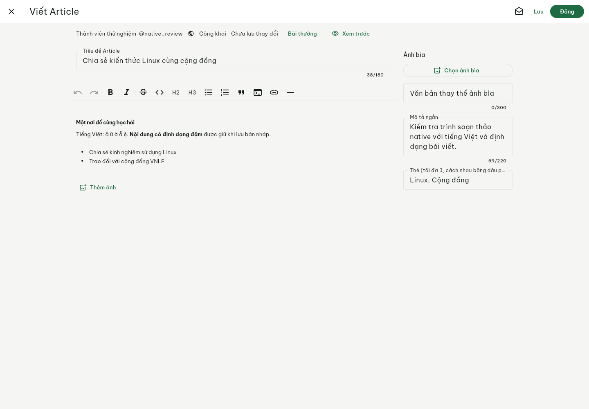
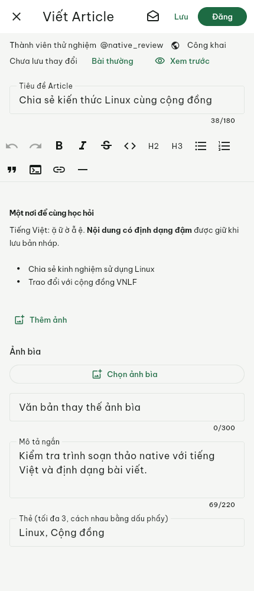

# Native article and composer review

Code checkpoint: `e9c1a3d`, following account isolation `b65fd37` and comment
controls `92ffa11`. Reference website was captured as a guest on November 5;
native Linux ARM64 release captures were refreshed on November 6.

Public reference route:
`https://vietnamlinuxfamily.net/a/luanti-co-le-cai-ten-hoi-la-voi-da-so-nguoi-dung-binh-thuong`.
The native article capture uses a guest session and a transport rejecting every
non-GET request. Composer captures use synthetic account/content data and a
transport that never contacts the server. No live content was created.

| Size | Website | Native Flutter |
| --- | --- | --- |
| Desktop 1440×1000 |  |  |
| Phone 430×1000 |  |  |

The website desktop capture repeats the sidebar at the far right because of a
compositor capture artifact. DOM inspection confirms one left sidebar.

The corrected native reader has the dedicated article hierarchy, a 702px desktop
body column, 13px live text sizing, 1.7 body line-height, collapsed adjacent block
margins and empty article paragraphs, and a flat phone layout with a 54px header.
Article/image attachment conversion preserves media instead of hiding it.

Remaining observed differences: desktop shell placement, avatar initials and
full decorations, phone navigation and fixed comment dock, image/caption
spacing, and emoji font fallback on this Linux host. These images demonstrate
progress and remaining gaps, not complete feature or visual parity.

## Native composer

| Desktop | Phone |
| --- | --- |
|  |  |

Live inherited 13px typography is explicit for paragraphs, headings, lists,
quotes and code. An authenticated website composer comparison and owner-account
write/read-back/cleanup checks remain pending.

## Validation

`flutter pub get`, formatting, analysis and all 362 Flutter tests passed before
the final editor block style adjustment; its 14 editor/codec tests and analysis
then passed. Native release compilation and all 11 Linux ELF architecture checks
passed. Build processes were capped at 3 GiB and 150% of one CPU; capture at
1 GiB and 100%, with one shared SDK slot. App/Xvfb capture processes stopped
on completion. No Flutter overflow/exception was logged. The headless GTK ATK
embedding warning leaves assistive-technology behavior unverified.
