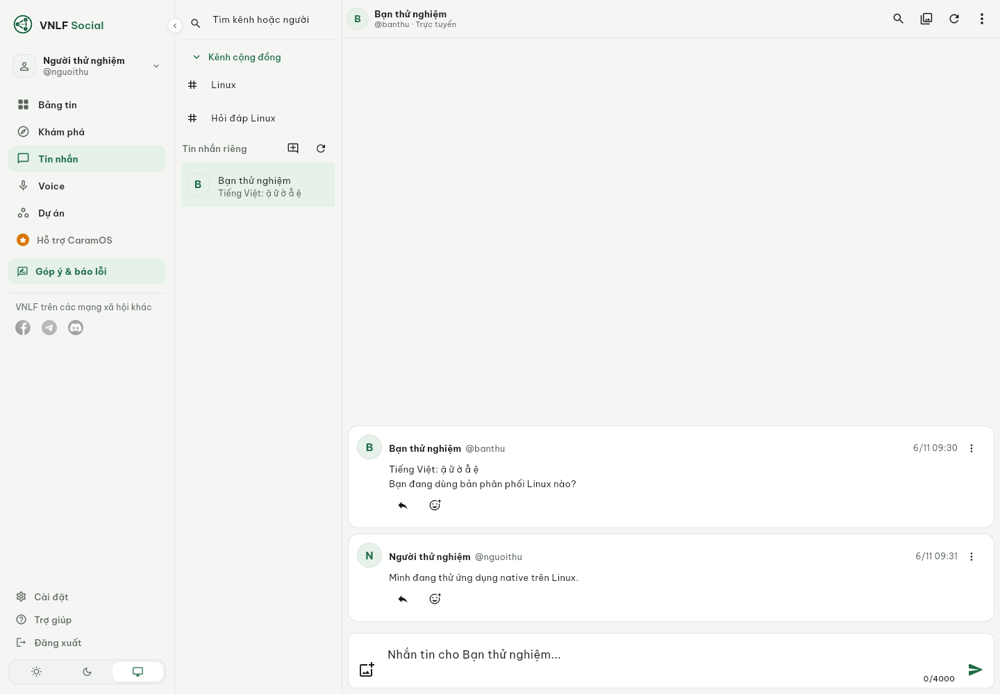
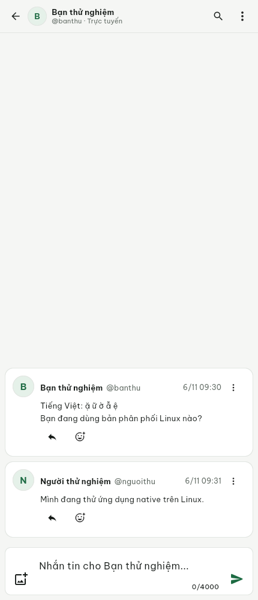
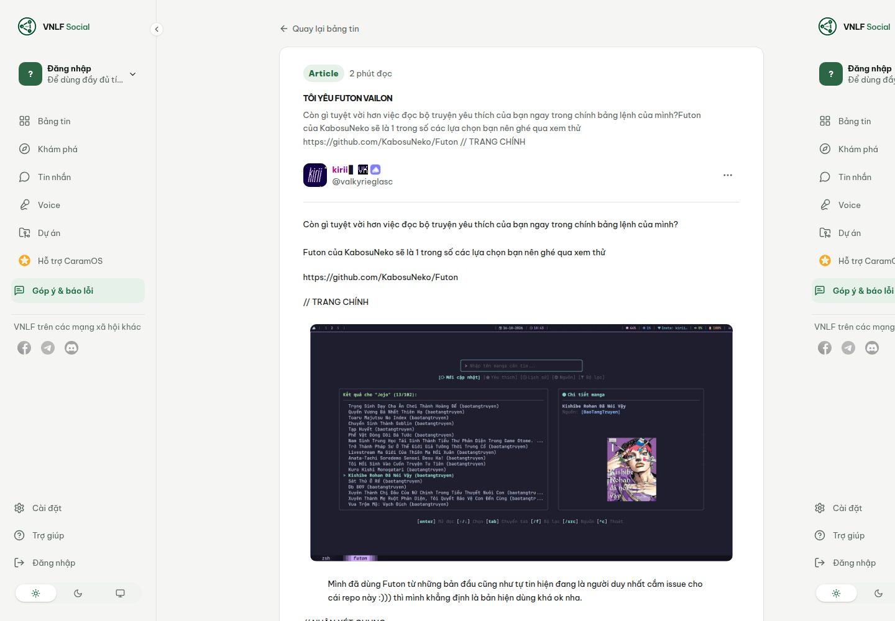
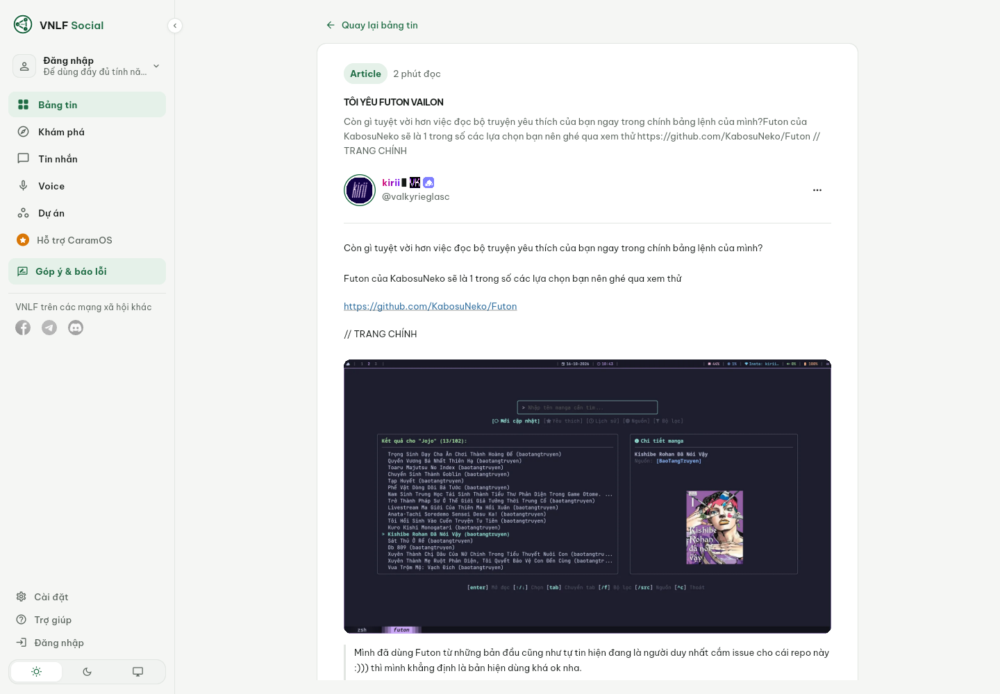
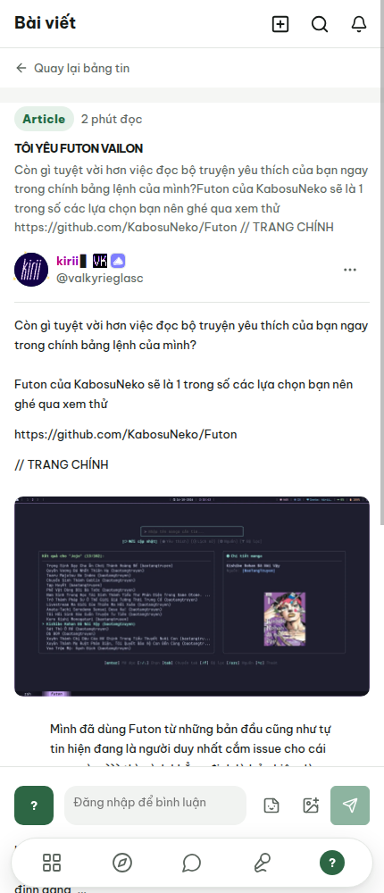
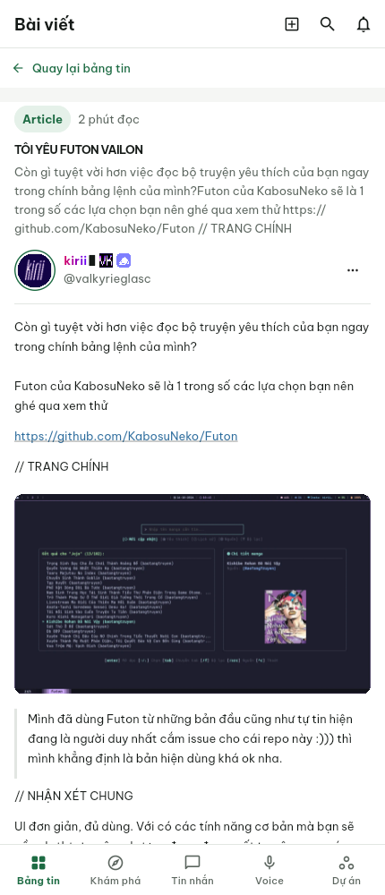
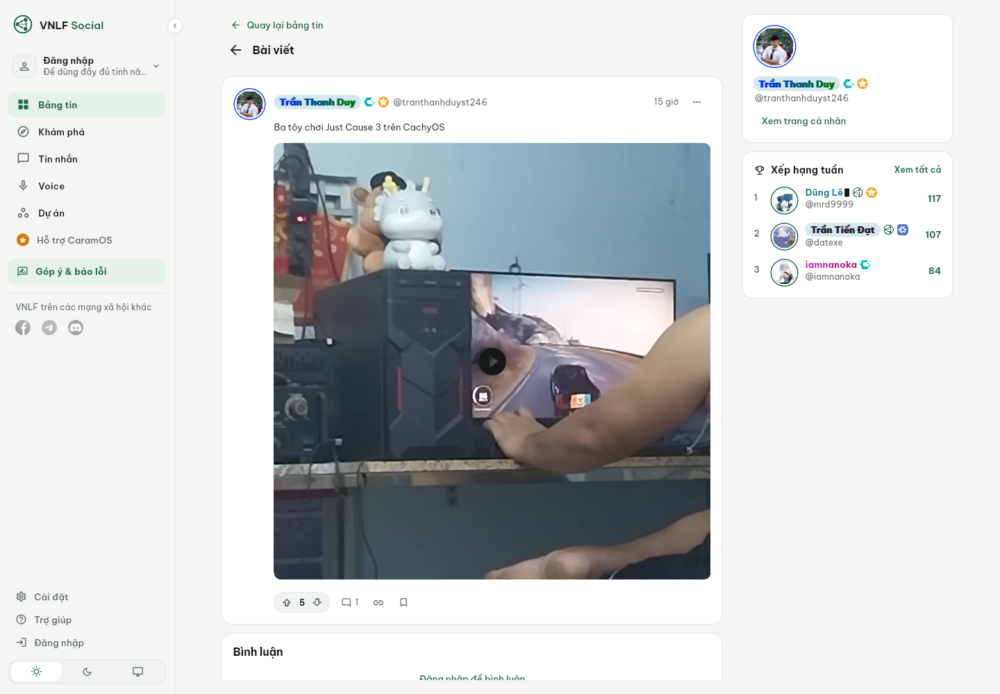
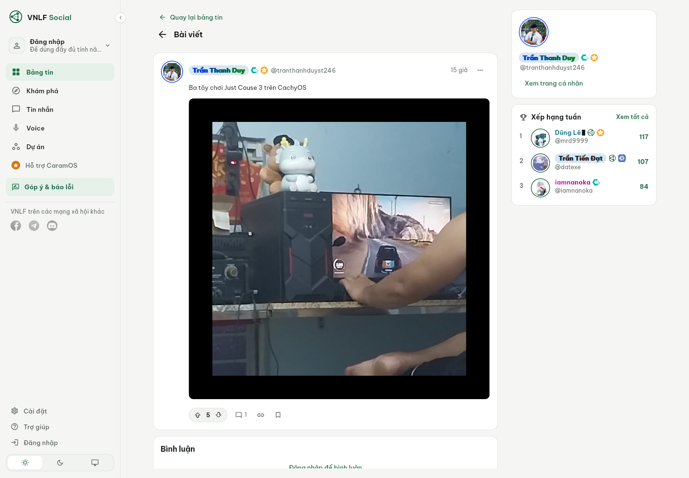
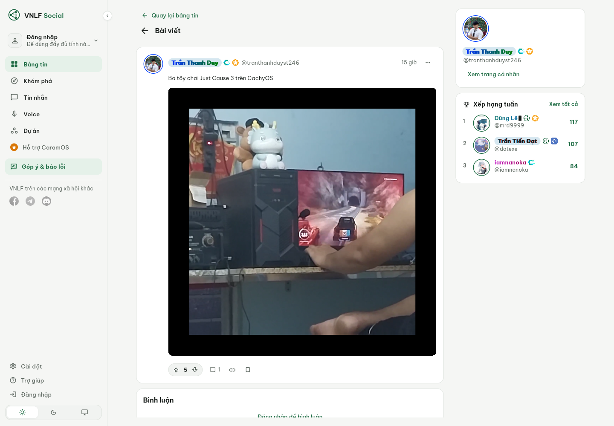

# Native article and composer review

Code checkpoint: `e9c1a3d`, following account isolation `b65fd37` and comment
controls `92ffa11`. Reference website was captured as a guest on November 5;
native Linux ARM64 release captures were refreshed on November 6.

Public reference route:
`https://vietnamlinuxfamily.net/a/luanti-co-le-cai-ten-hoi-la-voi-da-so-nguoi-dung-binh-thuong`.
The native article capture uses a guest session and a transport rejecting every
non-GET request. Composer captures use synthetic account/content data and a
transport that never contacts the server. No live content was created.

| Size | Website | Native Flutter |
| --- | --- | --- |
| Desktop 1440×1000 |  |  |
| Phone 430×1000 |  |  |

The website desktop capture repeats the sidebar at the far right because of a
compositor capture artifact. DOM inspection confirms one left sidebar.

The corrected native reader has the dedicated article hierarchy, a 702px desktop
body column, 13px live text sizing, 1.7 body line-height, collapsed adjacent block
margins and empty article paragraphs, and a flat phone layout with a 54px header.
Article/image attachment conversion preserves media instead of hiding it.

Remaining observed differences: desktop shell placement, avatar initials and
full decorations, phone navigation and fixed comment dock, image/caption
spacing, and emoji font fallback on this Linux host. These images demonstrate
progress and remaining gaps, not complete feature or visual parity.

## Native poll authoring and result bars

The new authoring captures exercise the actual composer, raw input recovery,
question/choice limits and phone layout. They use synthetic owner/content data
with a transport rejecting network calls. The result captures refresh the native
chat/feed poll surfaces after fixing the zero-height percentage fill. No writes
were made by these screenshot processes. The separate live HTTP persistence
checks are documented in API_NOTES.md and are not screenshots of a signed-in UI.

| Surface | Desktop 1440×1000 | Phone 430×1000 |
| --- | --- | --- |
| Poll authoring | [Native composer](native-composer-poll-desktop.png) | [Native composer](native-composer-poll-mobile.png) |
| Poll results | [Native results](native-polls-desktop.png) | [Native results](native-polls-mobile.png) |

Authoring follows the verified POST-only web controls and 200/100 UTF-16 limits;
native counters preserve emoji and incomplete choices. Source CSS and contracts
guide this layout, but no authenticated website authoring screenshot was captured
for this pass, so exact visual parity remains unverified.

## Native composer

| Desktop | Phone |
| --- | --- |
|  |  |

Live inherited 13px typography is explicit for paragraphs, headings, lists,
quotes and code. An authenticated website composer comparison and owner-account
write/read-back/cleanup checks remain pending.

## Validation

`flutter pub get`, formatting, analysis and all 362 Flutter tests passed before
the final editor block style adjustment; its 14 editor/codec tests and analysis
then passed. Native release compilation and all 11 Linux ELF architecture checks
passed. Build processes were capped at 3 GiB and 150% of one CPU; capture at
1 GiB and 100%, with one shared SDK slot. App/Xvfb capture processes stopped
on completion. No Flutter overflow/exception was logged. The headless GTK ATK
embedding warning leaves assistive-technology behavior unverified.

## Communication and public media runtime review

Messaging checkpoint: `be5e59e`. The combined directory and explicit routes run
through the same widgets used in production. These Linux captures use synthetic
account/history data and a transport that rejects mutations; they do not prove
live delivery or a complete authenticated website comparison.

| Desktop | Phone |
| --- | --- |
|  |  |

The source defines one searchable channel/DM directory, persistent channel
collapse, a 240px desktop/205px intermediate rail and a 54px chat header. Actual
route tests cover those widths, phone list/detail navigation, 1.6 text scaling,
request acknowledgment followed by read failure, and direct links that must not
open or mark another conversation read. Live-account checks stopped before a
request because this desktop session has no Secret Service keyring available.

A public article with an inline asset now renders that image in the native Linux
reader. Both website and native captures are guest reads of
`https://vietnamlinuxfamily.net/a/toi-yeu-futon-vailon`.

| Size | Website | Native Flutter |
| --- | --- | --- |
| Desktop |  |  |
| Phone |  |  |

The runtime video check found and reproduced a separate playback bug. MediaKit
reported a failed hardware codec attempt, then successfully decoded in software:
the diagnostic advanced to 8,933ms at 1280×1280. The app had treated every error
stream message as fatal and hidden its video surface. Fix `e0ab3e5` keeps the
surface mounted, waits for the first-frame signal, bounds startup, and disposes
stale/failed sessions. Six lifecycle/startup checks and all 403 Flutter tests pass;
formatting, analysis and dependency resolution pass.

The same public post (`01a1abd2-8b4f-7f8a-90a5-ce4df94697d1`) then played in the
actual native reader. The following unchanged captures, three seconds apart,
show different video frames. Poster display alone was not counted as playback.

| Poster | Playing, first capture | Playing, second capture |
| --- | --- | --- |
|  |  |  |

Capture processes and their Xvfb instances exited afterward. Native runtime logs
contain no Flutter overflow/exception. Headless software-renderer/audio warnings
remain environment limitations; audible output and physical-device performance
are unverified. Article quote/image spacing, shell placement, authenticated chat
styling, profiles/decorations and the other parity-audit gates remain open.

## Realtime connection notice

The disconnected notice has synthetic widget and route coverage. On this host,
two headless Linux capture attempts launched the application but did not produce
a visible first frame; no new screenshot is presented as visual evidence. The
existing [native communication capture](native-communication-desktop.png) shows
the prior normal state. Authenticated website parity and live delivery remain
unverified; the owner probe received HTTP 403 for the upgrade in this environment.
