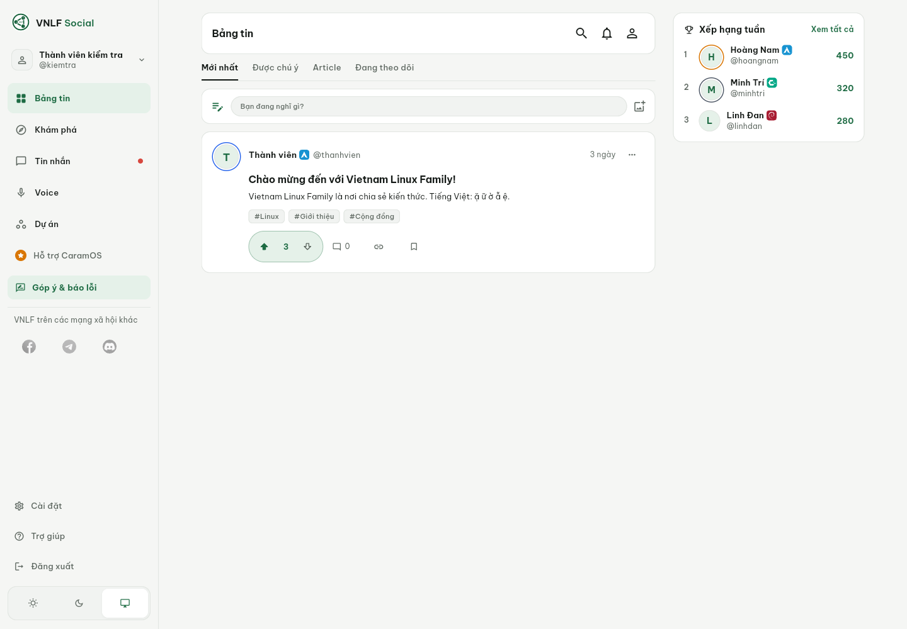

# Ảnh kiểm toán UX/UI native Linux — 08/11/2026

[Báo cáo đầy đủ](../../ux-ui-audit-2026-11-08.md).

Harness: `tool/ux_audit_capture.dart`. Dữ liệu tổng hợp trong bộ nhớ, tài khoản
giả lập, không có cookie/token thật, không kết nối website hoặc RTC. Đây là
renderer Linux ARM64 release được resize theo logical pixels; không phải ảnh
Android/iOS. Mỗi viewport cao 1000px, cỡ chữ mặc định; các tests riêng kiểm tra
chữ 200% và bàn phím ảo. Capture harness không khởi tạo các dịch vụ nền của
`MainApp`.

18 route surfaces và 4 panel/live presentations, mỗi loại có 390/900/1440px ở
hai theme. `voice` là demo offline của route; **`voice-live`** là production
presentation với repository/RTC boundary giả và roster speaking/muted tổng hợp.
Hai loại ảnh đều không chứng minh một cuộc gọi thật. `settings-*` là các panel
production tách riêng để kiểm tra ngoài wrapper offline. Composer có bản nháp
và poll giả được nạp từ recovery trong bộ nhớ.

## Đối chiếu reference

| Reference website lịch sử (read-only, ngoài repo) | Native cuối lượt audit, dữ liệu tổng hợp |
| --- | --- |
|  |  |

Website và native khác dữ liệu, trạng thái đăng nhập và chiều rộng reference;
bảng trên dùng đối chiếu ngôn ngữ thiết kế, không phải phép pixel-diff. Header
desktop, nhóm card, decoration và các mục trong báo cáo còn cần đối chiếu mới.
Ảnh website không được sao chép vào thư mục này.

## Chạy lại

```bash
tool/with_build_slot.sh flutter pub get
tool/with_build_slot.sh flutter build linux --release --no-pub --dart-define=VNLF_LIVE=false -t tool/ux_audit_capture.dart
xvfb-run -a -s '-screen 0 1600x1100x24' env GDK_BACKEND=x11 LIBGL_ALWAYS_SOFTWARE=1 VNLF_UX_OUTPUT=/tmp/vnlf-ux-final-captures build/linux/arm64/release/bundle/vnlfsocialapp
tool/with_build_slot.sh flutter analyze
tool/with_build_slot.sh flutter test --concurrency=1 --reporter expanded
```

Ứng dụng kiểm toán từ chối khởi chạy nếu thiếu `VNLF_LIVE=false`. Mạng bị chặn
thêm bằng `HttpOverrides`. `manifest.txt` ghi kích thước ảnh thật và số lỗi
Flutter, giúp tránh nhầm cửa sổ chưa resize hoặc chưa có first frame với ảnh
thành công. GTK/Xvfb có thể ghi cảnh báo ATK; ảnh không nghiệm thu assistive
technology, microphone, IME, hiệu năng hay các platform plugins trên thiết bị.

Capture cuối cùng hoàn tất với **132 PNG**, đúng kích thước 390/900/1440×1000,
**0 lỗi Flutter**, tiến trình thoát bình thường (exit 0). Manifest và kích thước
IHDR của từng ảnh đã được kiểm tra trước khi đưa vào thư mục này. Xvfb ghi cảnh
báo ATK và một cảnh báo chờ frame OpenGL lúc resize; ảnh auth đầu tiên đã được
mở kiểm tra và đúng bố cục/kích thước. Đây không phải bằng chứng hiệu năng GPU.
Harness dùng `SystemNavigator.pop` để đóng cửa sổ sau khi ghi xong manifest.

## Danh mục ảnh

Nhấn liên kết để mở ảnh nguyên kích thước. Mỗi ô có bản sáng và tối.

| Màn hình | Phone 390px | Tablet 900px | Desktop 1440px |
| --- | --- | --- | --- |
| Auth | [Sáng](login-390-light.png) · [Tối](login-390-dark.png) | [Sáng](login-900-light.png) · [Tối](login-900-dark.png) | [Sáng](login-1440-light.png) · [Tối](login-1440-dark.png) |
| Feed | [Sáng](feed-390-light.png) · [Tối](feed-390-dark.png) | [Sáng](feed-900-light.png) · [Tối](feed-900-dark.png) | [Sáng](feed-1440-light.png) · [Tối](feed-1440-dark.png) |
| Thread | [Sáng](thread-390-light.png) · [Tối](thread-390-dark.png) | [Sáng](thread-900-light.png) · [Tối](thread-900-dark.png) | [Sáng](thread-1440-light.png) · [Tối](thread-1440-dark.png) |
| Profile | [Sáng](profile-390-light.png) · [Tối](profile-390-dark.png) | [Sáng](profile-900-light.png) · [Tối](profile-900-dark.png) | [Sáng](profile-1440-light.png) · [Tối](profile-1440-dark.png) |
| Discover | [Sáng](discover-390-light.png) · [Tối](discover-390-dark.png) | [Sáng](discover-900-light.png) · [Tối](discover-900-dark.png) | [Sáng](discover-1440-light.png) · [Tối](discover-1440-dark.png) |
| Search | [Sáng](search-390-light.png) · [Tối](search-390-dark.png) | [Sáng](search-900-light.png) · [Tối](search-900-dark.png) | [Sáng](search-1440-light.png) · [Tối](search-1440-dark.png) |
| Leaderboard | [Sáng](leaderboard-390-light.png) · [Tối](leaderboard-390-dark.png) | [Sáng](leaderboard-900-light.png) · [Tối](leaderboard-900-dark.png) | [Sáng](leaderboard-1440-light.png) · [Tối](leaderboard-1440-dark.png) |
| Projects | [Sáng](projects-390-light.png) · [Tối](projects-390-dark.png) | [Sáng](projects-900-light.png) · [Tối](projects-900-dark.png) | [Sáng](projects-1440-light.png) · [Tối](projects-1440-dark.png) |
| Project detail | [Sáng](project-detail-390-light.png) · [Tối](project-detail-390-dark.png) | [Sáng](project-detail-900-light.png) · [Tối](project-detail-900-dark.png) | [Sáng](project-detail-1440-light.png) · [Tối](project-detail-1440-dark.png) |
| Project submission | [Sáng](project-submit-390-light.png) · [Tối](project-submit-390-dark.png) | [Sáng](project-submit-900-light.png) · [Tối](project-submit-900-dark.png) | [Sáng](project-submit-1440-light.png) · [Tối](project-submit-1440-dark.png) |
| Channels | [Sáng](channels-390-light.png) · [Tối](channels-390-dark.png) | [Sáng](channels-900-light.png) · [Tối](channels-900-dark.png) | [Sáng](channels-1440-light.png) · [Tối](channels-1440-dark.png) |
| Direct messages | [Sáng](messages-390-light.png) · [Tối](messages-390-dark.png) | [Sáng](messages-900-light.png) · [Tối](messages-900-dark.png) | [Sáng](messages-1440-light.png) · [Tối](messages-1440-dark.png) |
| Voice route offline | [Sáng](voice-390-light.png) · [Tối](voice-390-dark.png) | [Sáng](voice-900-light.png) · [Tối](voice-900-dark.png) | [Sáng](voice-1440-light.png) · [Tối](voice-1440-dark.png) |
| Voice live presentation / RTC fake | [Sáng](voice-live-390-light.png) · [Tối](voice-live-390-dark.png) | [Sáng](voice-live-900-light.png) · [Tối](voice-live-900-dark.png) | [Sáng](voice-live-1440-light.png) · [Tối](voice-live-1440-dark.png) |
| Activity | [Sáng](activity-390-light.png) · [Tối](activity-390-dark.png) | [Sáng](activity-900-light.png) · [Tối](activity-900-dark.png) | [Sáng](activity-1440-light.png) · [Tối](activity-1440-dark.png) |
| Feedback history | [Sáng](feedback-history-390-light.png) · [Tối](feedback-history-390-dark.png) | [Sáng](feedback-history-900-light.png) · [Tối](feedback-history-900-dark.png) | [Sáng](feedback-history-1440-light.png) · [Tối](feedback-history-1440-dark.png) |
| Feedback thread | [Sáng](feedback-thread-390-light.png) · [Tối](feedback-thread-390-dark.png) | [Sáng](feedback-thread-900-light.png) · [Tối](feedback-thread-900-dark.png) | [Sáng](feedback-thread-1440-light.png) · [Tối](feedback-thread-1440-dark.png) |
| Settings | [Sáng](settings-390-light.png) · [Tối](settings-390-dark.png) | [Sáng](settings-900-light.png) · [Tối](settings-900-dark.png) | [Sáng](settings-1440-light.png) · [Tối](settings-1440-dark.png) |
| Sessions panel | [Sáng](settings-sessions-390-light.png) · [Tối](settings-sessions-390-dark.png) | [Sáng](settings-sessions-900-light.png) · [Tối](settings-sessions-900-dark.png) | [Sáng](settings-sessions-1440-light.png) · [Tối](settings-sessions-1440-dark.png) |
| Blocked people panel | [Sáng](settings-blocked-390-light.png) · [Tối](settings-blocked-390-dark.png) | [Sáng](settings-blocked-900-light.png) · [Tối](settings-blocked-900-dark.png) | [Sáng](settings-blocked-1440-light.png) · [Tối](settings-blocked-1440-dark.png) |
| Privacy panel | [Sáng](settings-privacy-390-light.png) · [Tối](settings-privacy-390-dark.png) | [Sáng](settings-privacy-900-light.png) · [Tối](settings-privacy-900-dark.png) | [Sáng](settings-privacy-1440-light.png) · [Tối](settings-privacy-1440-dark.png) |
| Composer + poll | [Sáng](composer-390-light.png) · [Tối](composer-390-dark.png) | [Sáng](composer-900-light.png) · [Tối](composer-900-dark.png) | [Sáng](composer-1440-light.png) · [Tối](composer-1440-dark.png) |

[Kích thước và lỗi renderer trong manifest](manifest.txt).

## Kết quả kiểm chứng cuối cùng

| Lệnh / kiểm tra | Kết quả |
| --- | --- |
| `tool/with_build_slot.sh flutter pub get` | Exit 0; không thêm dependency hoặc sửa pubspec/lockfile. |
| `dart format --output=none --set-exit-if-changed` trên `lib`, các tests mới/test sửa và `tool/ux_audit*.dart` | 298 files, 0 thay đổi định dạng; exit 0. |
| `tool/with_build_slot.sh flutter analyze` | No issues found; exit 0. |
| `tool/with_build_slot.sh flutter test --no-pub --concurrency=1 --reporter expanded` | **816 tests passed**, exit 0; thời gian test runner 5 phút 38 giây. |
| Linux ARM64 release build với entrypoint kiểm toán | Exit 0; chạy được bundle native. Đây không phải build phát hành production. |
| Chạy bundle trong Xvfb | Exit 0; **132 PNG**, **0 lỗi Flutter**; có cảnh báo ATK/OpenGL môi trường đã ghi ở trên. |
| Kiểm tra PNG IHDR và manifest | Đủ 132 ảnh, đúng 390/900/1440×1000, hai theme; tổng khoảng 8 MB. |
| `git diff --check` | Exit 0. |

31 tests mới gồm matrix UX, contrast trên controls thực và các trường hợp nội
dung chi tiết; một test Search hiện hữu được sửa để cuộn tới chip ngoài viewport
trước khi bấm. Các assertion kết quả tìm kiếm vẫn giữ nguyên. Tests mới đã tái
hiện lỗi trước khi sửa. Không có live login, post/comment/reaction/upload hoặc
thay đổi cài đặt máy chủ trong lượt kiểm toán.
